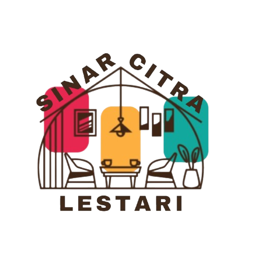

<p align="center">
  
</p>

<h1 align="center">Sinar Citra Lestari (SCL)</h1>
<h3 align="center">Sistem Informasi Manajemen Kos & Portal Reservasi Hunian Modern</h3>

<p align="center">
  Platform manajemen properti dan reservasi hunian kos berbasis web modern dengan arsitektur SaaS (Software as a Service). Dirancang untuk memberikan pengalaman reservasi yang transparan, aman, dan instan bagi calon penyewa, serta kontrol operasional harian yang rapi, efisien, akuntabel, dan bebas kerumitan bagi pemilik maupun pengelola kos.
</p>

<p align="center">
  
  
  
  
  
  
</p>

---

## 📌 Daftar Isi
1. [Tentang Website](#-tentang-website)
2. [Fitur Utama Sistem](#-fitur-utama-sistem)
   - [A. Portal Publik (Frontend Calon Penyewa)](#a-portal-publik-frontend-calon-penyewa)
   - [B. Backend Dashboard Admin (Modern SaaS Concept)](#b-backend-dashboard-admin-modern-saas-concept)
   - [C. Integrasi Metode Pembayaran Real-Time](#c-integrasi-metode-pembayaran-real-time)
   - [D. Integrasi Sosial Media Terpusat](#d-integrasi-sosial-media-terpusat)
   - [E. Kelola Artikel Blog & Tips Edukasi](#e-kelola-artikel-blog--tips-edukasi)
   - [F. Sistem Notifikasi Email & PDF Otomatis](#f-sistem-notifikasi-email--pdf-otomatis)
3. [Arsitektur Keamanan & Proteksi Sistem](#-arsitektur-keamanan--proteksi-sistem)
4. [Alur Kerja Sistem (Workflow Diagrams)](#-alur-kerja-sistem-workflow-diagrams)
   - [1. Alur Reservasi Calon Penyewa](#1-alur-reservasi-calon-penyewa)
   - [2. Alur Approval Admin & Auto-Rejection](#2-alur-approval-admin--auto-rejection)
   - [3. Alur Otomasi Ketersediaan Kamar](#3-alur-otomasi-ketersediaan-kamar)
5. [Teknologi yang Digunakan (Tech Stack)](#-teknologi-yang-digunakan-tech-stack)
6. [Struktur Direktori Proyek](#-struktur-direktori-proyek)
7. [Panduan Instalasi & Menjalankan Sistem](#-panduan-instalasi--menjalankan-sistem)
8. [Verifikasi Pengujian Otomatis (Automated Testing)](#-verifikasi-pengujian-otomatis-automated-testing)
9. [Lisensi & Hak Cipta](#-lisensi--hak-cipta)

---

## 🏢 Tentang Website

**Sinar Citra Lestari (SCL)** adalah platform manajemen hunian sewa kos terintegrasi. Aplikasi ini mempertemukan calon penghuni kos dengan pengelola secara langsung tanpa perantara calo.

Sistem ini dibangun dengan filosofi **"Less but Better"** — memprioritaskan efisiensi, kemudahan penggunaan, kejelasan hierarki visual, dan integritas data yang kokoh:
1. **Untuk Calon Penghuni**: Memberikan transparansi ketersediaan kamar secara *real-time*, rincian tarif sewa (jam, hari, minggu, bulan, tahun), galeri foto bento-grid, peta lokasi interaktif, simulasi biaya sewa, pilihan transfer bank/QRIS/tunai, serta bukti reservasi digital instan.
2. **Untuk Pengelola Kos (Admin & Super Admin)**: Menyediakan dashboard pemantauan operasional yang bersih dan intuitif, verifikasi bukti pembayaran privat, audit trail persetujuan booking, pencegahan bentrok jadwal (*double-booking collision*), dan otomasi pelepasan kamar kosong saat masa sewa berakhir.

---

## ⚡ Fitur Utama Sistem

### A. Portal Publik (Frontend Calon Penyewa)
* **Katalog Properti & Pencarian Cerdas**:
  - Filter lokasi wilayah (Denpasar, Badung, Gianyar, Tabanan, dll.), rentang tarif sewa, nama properti, dan fasilitas.
  - Penanda status hunian *real-time* (**Siap Huni** vs **Terisi Penuh**).
* **Halaman Detail Properti Kos**:
  - **Galeri Bento Grid**: Tampilan galeri foto properti modern yang responsif dan dilengkapi mode *Lightbox Layar Penuh* (100% tanpa terpotong).
  - **Peta Interaktif (Leaflet.js & OpenStreetMap)**: Peta lokasi dengan fitur *layer switcher* (Street View & Citra Satelit Esri), tombol rute Google Maps instan, serta proteksi *gesture mobile* (anti scroll-trap saat pengguna menggulir layar di HP).
  - **Daftar Unit Kamar Cerdas**: Tombol dinamis **Pesan Langsung** jika kamar siap huni, atau **Waiting List via WhatsApp** jika kamar sedang penuh.
  - **FAQ Interaktif**: Pertanyaan umum seputar survei lokasi, aturan deposit, dan tata cara check-in.
* **Halaman Detail Kamar**:
  - **Two-Tier Facilities**: Pemisahan jelas antara fasilitas khusus kamar tidur (AC, Kasur, Kamar Mandi Dalam) dengan fasilitas bersama gedung kos (Dapur bersama, WiFi, Parkir motor/mobil).
  - **Kalkulator Biaya Sewa Dinamis**: Estimasi biaya sewa transparan berdasarkan durasi yang dipilih.
* **Formulir Reservasi Aman & Proteksi Bot**:
  - Kalender Flatpickr interaktif untuk tanggal masuk (*check-in*).
  - Pilihan durasi fleksibel (kombinasi jam, hari, minggu, bulan, atau tahun).
  - Pilihan metode bayar dinamis (Transfer Bank, Scan Barcode QRIS, Tunai di Tempat).
  - Upload bukti transfer dengan validasi format dan ukuran file maksimal 5MB.
  - **Cloudflare Turnstile Anti-Bot**: Smart CAPTCHA yang memverifikasi keaslian browser manusia tanpa puzzle yang merepotkan.
  - **Pre-Submission Review Modal**: Dialog konfirmasi sebelum submit untuk meninjau Nama, WhatsApp, Email, Tanggal Check-in, dan Nominal Biaya. Mencegah kesalahan ketik kontak yang berisiko membuat tiket PDF salah kirim.
* **Halaman Sukses & Download Invoice Mandiri**:
  - Tautan akses unik (*Access Token*) aman untuk setiap reservasi.
  - Unduh kwitansi bukti booking format PDF secara mandiri kapan saja.

---

### B. Backend Dashboard Admin (Modern SaaS Concept)
Dashboard administrasi didesain dengan konsep **Modern Professional SaaS Dashboard — Clean, Minimalist, Elegant & Premium**:
* **Sidebar Sticky Berkelompok**:
  - Terorganisasi rapi ke dalam 3 kelompok menu esensial:
    1. **Operasional**: Dashboard Utama, Permintaan Booking, Kos-kosan, Kamar Kosan.
    2. **Konten Publik**: Kelola Artikel Blog, Sosial Media.
    3. **Pengaturan**: Metode Pembayaran, Kelola Pengguna, Profil Akun.
  - Sticky sidebar desktop (100vh) dan drawer mobile responsif.
* **Quick Search Palette (`Ctrl + K` / `Cmd + K`)**:
  - Modal navigasi cepat untuk berpindah antar menu dan data dalam hitungan detik.
* **4 Kartu KPI Utama**:
  - **Tingkat Okupansi**: Persentase keterisian kamar dengan progress bar visual.
  - **Kamar Siap Huni**: Jumlah kamar kosong yang siap disewakan.
  - **Pendapatan Bulan Ini**: Total transaksi sewa yang disetujui pada bulan berjalan.
  - **Total Omset**: Akumulasi total pendapatan yang tercatat di sistem.
* **Grafik Tren Pendapatan 6 Bulan**: Visualisasi tren pendapatan berbasis data riil per bulan.
* **Performa Seluruh Properti Cabang**: Tabel ringkasan tingkat hunian tiap unit kos.
* **Notifikasi Operasional Bersih**: Peringatan hanya muncul ketika ada **Booking Baru yang Menunggu Persetujuan (Pending)**. Tidak memunculkan peringatan palsu jika kamar memang sudah otomatis selesai masa sewanya.

---

### C. Integrasi Metode Pembayaran Real-Time
Modul manajemen metode pembayaran terintegrasi penuh antara backend dan formulir reservasi publik:
* **Mendukung 3 Jenis Pembayaran**:
  - **Transfer Bank**: Nomor rekening, nama bank, dan nama pemilik rekening.
  - **QRIS**: Unggah gambar barcode QRIS dengan pratinjau instan (*instant preview*).
  - **Tunai (Cash)**: Pembayaran langsung di tempat saat serah terima kunci.
* **Toggle Status Aktif/Nonaktif**: Admin dapat mengaktifkan atau menonaktifkan metode pembayaran kapan saja dengan sakelar switch.
* **Safety Guard Proteksi**: Sistem mencegah penghapusan atau penonaktifan jika hanya tersisa satu metode pembayaran aktif (mencegah jalan buntu pada formulir reservasi penyewa).
* **Sinkronisasi Otomatis**: Form reservasi front-end secara *real-time* mengambil daftar rekening dan barcode QRIS yang berstatus aktif di backend.

---

### D. Integrasi Sosial Media Terpusat
* Pengelolaan tautan sosial media resmi (WhatsApp, Instagram, TikTok, Facebook, YouTube, dll.).
* **Integrasi Otomatis ke Front-End**: Ikon dan tautan sosial media di Navbar maupun Footer website publik langsung membaca data dari tabel database backend secara dinamis.
* **Pembatasan Hak Akses**: Hanya dapat diakses dan diubah oleh Super Admin.

---

### E. Kelola Artikel Blog & Tips Edukasi
Modul publikasi konten untuk artikel edukasi sewa, tips hunian, dan panduan calon penyewa:
* **Toolbar SaaS Modern & Bersih**:
  - Mengeliminasi tombol-tombol yang tidak perlu (subscript, superscript, ukuran font acak, tabel rusak).
  - Dilengkapi dropdown **"Gaya Teks ▾"** yang jelas (*Normal/Paragraf, Judul Bab H2, Sub-Bab H3, Sub-Bagian H4, Kutipan Quote*).
  - Format esensial: Tebal, Miring, Garis Bawah, Coret, Bullet List, Numbered List, Link, dan Garis Pemisah.
* **Bebas Masalah Focus Trap**: Input dialog tautan (Link) Summernote dapat diklik dan diketik dengan lancar tanpa terganggu modal Bootstrap 5.
* **Mode Fullscreen Bebas Distraksi**: Kanvas menulis terpusat 860px ala Medium / Notion untuk mengetik artikel panjang dengan nyaman.
* **Upload Sampul Tervalidasi**: Input gambar sampul artikel terdedikasi dengan pratinjau instan, validasi format JPG/PNG/WEBP, dan batas maksimal 5MB.
* **Live Search & Sort AJAX**: Pencarian artikel instan secara real-time dan pengurutan (Terbaru, Terpopuler, Terlama, A-Z).
* **Sanitasi HTML Otomatis**: Backend membersihkan tag berbahaya (`<script>`, `<iframe>`, inline style mencolok, atribut scrap AI) untuk menjaga konsistensi tampilan dan keamanan sistem.

---

### F. Sistem Notifikasi Email & PDF Otomatis
Sistem menerapkan arsitektur notifikasi email berjenjang (*3-stage email workflow*):
1. **Email Tanda Terima Permohonan (Tanpa Lampiran PDF)**:
   - Terkirim seketika setelah penyewa menyelesaikan permohonan reservasi di website.
   - Memberitahukan bahwa data telah masuk antrean verifikasi pengelola (status: *Pending*).
2. **Email Persetujuan / Approved (DENGAN Lampiran PDF Kwitansi Lunas)**:
   - Terkirim otomatis saat admin menekan tombol **Setujui** di dashboard.
   - Melampirkan berkas resmi `Bukti-Reservasi-Lunas-Kos-#{ID}.pdf` berstatus **DISETUJUI / LUNAS** yang dapat dicetak untuk serah terima kunci kamar.
   - Menyediakan panduan *check-in* dan tautan langsung ke WhatsApp pengelola kos.
3. **Email Penolakan / Rejected (Tanpa Lampiran PDF)**:
   - Terkirim otomatis saat admin menekan tombol **Tolak** di dashboard.
   - Menyertakan alasan penolakan secara transparan dan tombol bantuan WhatsApp admin untuk instruksi klarifikasi atau pengembalian dana (*refund*).

---

## 🔒 Arsitektur Keamanan & Proteksi Sistem

| Aspek Keamanan | Mekanisme Implementasi |
| :--- | :--- |
| **Pencegahan Double-Booking** | Database transaction dengan pengecekan tumpang tindih tanggal sewa. Saat sebuah booking disetujui, booking pending lain yang bertabrakan otomatis ditolak (*auto-reject*). |
| **Kalkulasi Biaya Server-Side** | Total harga sewa dihitung 100% di backend (`ProcessBookingDate`) berdasarkan tarif riil di database. Form di browser tidak bisa memanipulasi total harga sewa. |
| **Proteksi Privasi Bukti Transfer** | File bukti transfer disimpan di direktori privat (`private storage`) dan hanya dapat diakses melalui rute terotentikasi admin (`admin.booking.proof`), bukan folder publik. |
| **Role-Based Access Control (RBAC)** | Pemisahan ketat antara `super_admin` dan `admin_cabang`. Admin cabang dibatasi hanya pada kosan miliknya dan dilarang mengakses modul Users, Metode Pembayaran, dan Sosial Media (`403 Forbidden`). |
| **Proteksi Bot Cloudflare Turnstile** | Smart CAPTCHA di halaman Login Admin dan Form Booking untuk menangkal serangan bot, spam, dan credential stuffing. |
| **Proteksi SQL Injection & XSS** | Seluruh kueri menggunakan parameterized binding Eloquent ORM. Input deskripsi disanitasi oleh `Artikel::sanitizeHtml` dan fungsi `strip_tags()`. |
| **Proteksi Integritas Data** | Kamar dengan penghuni aktif dilarang dihapus, dan data riwayat penyewa dilindungi oleh mekanisme *Soft Deletes*. |
| **Proteksi Brute-Force & Flooding** | Rate limiter aktif pada rute login (`throttle:5,1`) dan rute booking (`throttle:10,1`). |

---

## 🔄 Alur Kerja Sistem (Workflow Diagrams)

### 1. Alur Reservasi Calon Penyewa
```text
[Pengunjung Membuka Web]
       │
       ▼
[Katalog / Detail Kosan] ──► Cek fasilitas, lokasi peta satelit & unit kamar
       │
       ▼
[Pilih Unit Kamar] ────────► Cek Status:
                                  │
              ┌───────────────────┴───────────────────┐
              ▼                                       ▼
       [Status: Siap Huni]                     [Status: Terisi Penuh]
              │                                       │
              ▼                                       ▼
     [Klik "Pesan Langsung"]                 [Klik "Waiting List WA"]
              │                               (Terhubung ke WhatsApp Admin)
              ▼
     [Isi Formulir Booking]
     - Nama, No. WhatsApp, Email
     - Tanggal & Jam Check-In
     - Pilihan Durasi (Hari/Minggu/Bulan/Tahun)
     - Verifikasi Cloudflare Turnstile
     - Pilih Metode Bayar (Bank / QRIS / Tunai) & Upload Bukti Transfer
              │
              ▼
     [Review Modal Pra-Submit]
     - Konfirmasi kebenaran data & nominal bayar
              │
              ▼
     [Submit Reservasi]
              │
              ├─ Data tersimpan dengan status 'pending'
              ├─ Generate Unique Access Token
              ├─ Halaman Booking Berhasil ditampilkan
              └─ Email 1 Terkirim Otomatis ("Tanda Terima Antrean")
```

### 2. Alur Approval Admin & Auto-Rejection
```text
[Admin Login Dashboard] ──► Diproteksi Turnstile & Rate Limiter
            │
            ▼
[Menu Permintaan Booking]
            │
            ▼
[Periksa Rincian & Bukti Transfer Tamu (Akses Privat)]
            │
      ┌─────┴────────────────────────────────────────────────┐
      ▼                                                      ▼
[KLIK SETUJUI (APPROVE)]                              [KLIK TOLAK (REJECT)]
      │                                                      │
      ├─ Status diubah menjadi 'approved'                    ├─ Pilih / ketik alasan penolakan
      ├─ Kunci kamar otomatis terisi                         ├─ Status diubah menjadi 'reject'
      ├─ Booking tumpang tindih DITOLAK otomatis             ├─ Audit trail tercatat
      ├─ Audit trail admin tercatat                          │
      ├─ Invalidate cache ketersediaan                       ▼
      ├─ Generate PDF Kwitansi Lunas              [Email 2B Terkirim Otomatis]
      │                                           - Berisi Alasan Penolakan
      ▼                                           - Petunjuk Refund / Klarifikasi
[Email 2A Terkirim Otomatis]                      - Tombol Bantuan WhatsApp Admin
- Lampiran PDF Kwitansi Lunas Resmi
- Petunjuk Check-in Kamar
- Tombol WhatsApp Pengelola Kos
```

### 3. Alur Otomasi Ketersediaan Kamar
```text
[Hari Berjalan / Tanggal Hari Ini]
                │
                ▼
   [Cek Periode Sewa Aktif]
  (start_date <= Hari Ini <= end_date)
                │
    ┌───────────┴───────────┐
    ▼                       ▼
[Periode Masih Aktif]   [Periode Sewa Berakhir (end_date < Hari Ini)]
    │                       │
    ▼                       ▼
Kamar berstatus         Kamar OTOMATIS LEPAS & KOSONG (Siap Huni)
"Terisi"                - Siap dipesan oleh calon penyewa baru di web
                        - Data sewa lama tetap tersimpan sebagai arsip
```

---

## 🛠️ Teknologi yang Digunakan (Tech Stack)

### Backend & Database
* **Framework**: Laravel 12.x
* **Bahasa**: PHP 8.2 / 8.3+
* **Database**: MySQL 8.x / MariaDB (InnoDB Storage Engine)
* **PDF Generator**: `barryvdh/laravel-dompdf` (DomPDF Engine)
* **Email Service**: Laravel Mailable dengan protokol SMTP (Gmail TLS)
* **Anti-Bot Security**: Cloudflare Turnstile API & Custom Laravel Validation Rule

### Frontend & Antarmuka Pengguna
* **Template Engine**: Laravel Blade
* **CSS Framework**: Tailwind CSS v3 / v4 (Frontend Publik)
* **Admin Dashboard UI**: Bootstrap 5.3 + AdminLTE v4 + Custom SaaS Design System
* **Rich Text Editor**: Summernote Lite (dikonfigurasi bersih & bebas focus trap)
* **Peta Digital**: Leaflet.js 1.9.4 dengan OpenStreetMap & Esri World Imagery
* **Datepicker**: Flatpickr (dengan tema kustom SCL & lokalisasi bahasa Indonesia)
* **Bundler & Tooling**: Vite 7.x

---

## 📂 Struktur Direktori Proyek

```text
kosan-main/
├── app/
│   ├── Console/Commands/
│   │   └── ExpirePendingBookings.php # Command pembersihan booking pending kedaluwarsa
│   ├── Http/Controllers/
│   │   ├── Admin/                   # Controller panel administrasi
│   │   │   ├── AdminManagementController.php
│   │   │   ├── BookingAdminController.php
│   │   │   ├── DashboardController.php
│   │   │   ├── KamarKosanController.php
│   │   │   ├── KosanController.php
│   │   │   ├── PaymentMethodController.php # Kelola Bank & QRIS
│   │   │   ├── ProfileController.php
│   │   │   └── SosialMediaController.php   # Kelola Sosial Media
│   │   ├── ArtikelController.php    # CRUD & Live Search Artikel Blog
│   │   ├── Auth/                    # Autentikasi Admin & Turnstile
│   │   ├── Frontend/                # Controller halaman publik & katalog kos
│   │   └── TamuBookingController.php # Pemrosesan transaksi & invoice publik
│   ├── Mail/                        # Berkas Mailable (Approval, Rejection, Confirmation)
│   ├── Models/                      # Eloquent Models (ProductKosan, Tamu, Artikel, dll.)
│   ├── Rules/TurnstileRule.php      # Rule validasi Cloudflare Turnstile
│   └── Service/ProcessBookingDate.php # Kalkulator sewa & jadwal server-side
├── database/
│   ├── migrations/                  # Skema database relasional
│   └── seeders/                     # Seeder data default (User, Kosan, Kamar, dll.)
├── public/
│   ├── assets-dashboard-admin/      # Aset CSS & JS khusus panel admin SaaS
│   │   └── css/custom-admin.css     # Design system dashboard admin
│   └── build/                       # Kompilasi aset Vite (CSS/JS publik)
├── resources/
│   └── views/
│       ├── backend/dashboard/       # Tampilan antarmuka Dashboard Admin
│       │   ├── artikel/             # Modul kelola artikel blog
│       │   ├── payment-methods/     # Modul kelola metode pembayaran
│       │   ├── permintaan-booking/  # Modul audit & approval booking
│       │   ├── sosial-media/        # Modul kelola sosial media
│       │   └── users/               # Modul kelola admin pengguna
│       ├── emails/                  # Template email Blade notifikasi
│       ├── frontend/                # Tampilan antarmuka website publik
│       └── pdf/booking_invoice.blade.php # Template kwitansi resmi PDF
├── routes/
│   ├── web.php                      # Rute web publik & terproteksi admin
│   └── console.php                  # Jadwal artisan command berkala
└── tests/
    ├── Feature/                     # Suite pengujian otomatis (29 tests)
    │   ├── AdminDashboardPagesTest.php
    │   ├── ArtikelManagementTest.php
    │   ├── ComprehensiveSystemTest.php
    │   ├── PaymentMethodManagementTest.php
    │   └── SosialMediaIntegrationTest.php
    └── Unit/
```

---

## 🚀 Panduan Instalasi & Menjalankan Sistem

### 1. Kloning Repository
```bash
git clone https://github.com/PrimaCyu/suryakosan-main.git
cd suryakosan-main
```

### 2. Instalasi Dependensi Backend (Composer)
```bash
composer install
```

### 3. Instalasi Dependensi Frontend (NPM)
```bash
npm install
npm run build
```

### 4. Konfigurasi Environment (`.env`)
Salin file konfigurasi contoh:
```bash
cp .env.example .env
```
Buka berkas `.env` dan sesuaikan parameter berikut:
```env
APP_NAME="Sinar Citra Lestari"
APP_ENV=local
APP_KEY=
APP_DEBUG=true
APP_URL=http://127.0.0.1:8001

DB_CONNECTION=mysql
DB_HOST=127.0.0.1
DB_PORT=3306
DB_DATABASE=kosan_db
DB_USERNAME=root
DB_PASSWORD=

# Konfigurasi Pengiriman Email (SMTP Gmail TLS)
MAIL_MAILER=smtp
MAIL_HOST=smtp.gmail.com
MAIL_PORT=587
MAIL_USERNAME=emailanda@gmail.com
MAIL_PASSWORD=app_password_gmail_anda
MAIL_ENCRYPTION=tls
MAIL_FROM_ADDRESS="emailanda@gmail.com"
MAIL_FROM_NAME="${APP_NAME}"

# Konfigurasi Cloudflare Turnstile Anti-Bot
TURNSTILE_ENABLED=true
TURNSTILE_SITE_KEY=1x00000000000000000000AA
TURNSTILE_SECRET_KEY=1x00000000000000000000000000000000AA
```

### 5. Generate Application Key & Storage Link
```bash
php artisan key:generate
php artisan storage:link
```

### 6. Migrasi Database & Seeding
```bash
php artisan migrate --seed
```

### 7. Menjalankan Server Lokal
Jalankan server database MySQL (misalnya via Laragon/XAMPP), lalu buka server Laravel:
```bash
php artisan serve --host=127.0.0.1 --port=8001
```
Aplikasi kini dapat diakses melalui browser:
* **Website Publik**: `http://127.0.0.1:8001`
* **Dashboard Admin**: `http://127.0.0.1:8001/admin/dashboard`

---

## 🧪 Verifikasi Pengujian Otomatis (Automated Testing)

Sistem telah dilengkapi dengan automated test suite berbasis PHPUnit / Pest untuk menjamin keamanan dan keandalan fitur sebelum siap rilis.

Jalankan seluruh pengujian dengan perintah:
```bash
php artisan test
```

Hasil verifikasi:
```text
   PASS  Tests\Unit\ExampleTest
  ✓ that true is true

   PASS  Tests\Feature\AdminDashboardPagesTest
  ✓ all admin dashboard pages render cleanly for super admin
  ✓ branch admin dashboard and assigned pages render cleanly

   PASS  Tests\Feature\ArtikelManagementTest
  ✓ super admin can view artikel index page
  ✓ artikel ajax search returns filtered results
  ✓ super admin can create article with image
  ✓ super admin can update article
  ✓ super admin can delete article
  ✓ article validation prevents empty fields

   PASS  Tests\Feature\ComprehensiveSystemTest
  ✓ security headers are present on web responses
  ✓ booking total price is strictly computed server side
  ✓ proof of transfer is required for transfer and stored privately
  ✓ branch admin cannot access or modify unauthorized kosan subresources
  ✓ branch admin cannot access super admin social media and users
  ✓ soft deletes preserves tenant records when room is deleted
  ✓ cannot delete room with active occupant
  ✓ approving booking auto rejects colliding pending bookings
  ✓ expire pending command cleans stale bookings

   PASS  Tests\Feature\PaymentMethodManagementTest
  ✓ super admin can view payment methods page
  ✓ branch admin is forbidden from payment methods
  ✓ super admin can create new bank payment method
  ✓ super admin can upload qris image
  ✓ cannot deactivate or delete the only active method
  ✓ customer can book with newly added active method

   PASS  Tests\Feature\SosialMediaIntegrationTest
  ✓ super admin can access sosial media management
  ✓ branch admin cannot access sosial media management
  ✓ super admin can create update and delete sosial media
  ✓ frontend reflects sosial media in footer and navbar

Tests:    29 passed (109 assertions)
Status:   100% PASS
```

---

## 🔒 Lisensi & Hak Cipta
Hak Cipta &copy; 2026 **Sinar Citra Lestari**. Seluruh hak cipta dilindungi undang-undang.  
Dilarang keras menyalin, menduplikasi, atau mendistribusikan ulang kode sumber ini tanpa izin tertulis dari pemilik proyek.
